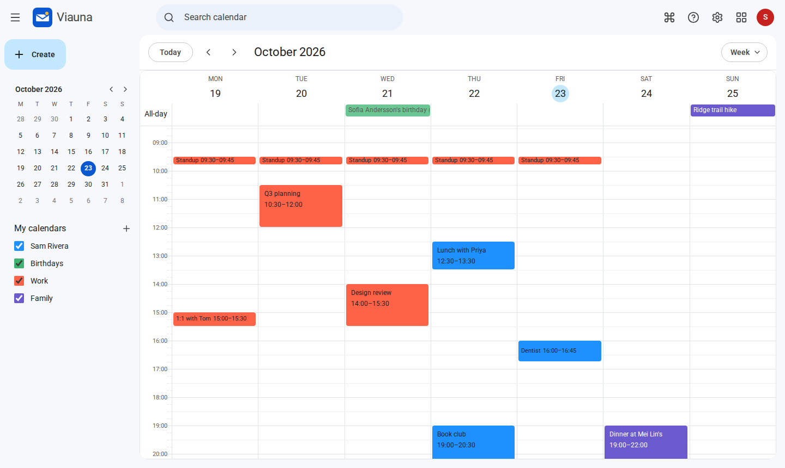

# Viauna

**A fast, Gmail-style webmail client for any IMAP/SMTP server.** Self-hosted, one
container, no database server to run. Point it at the mail server you already have and
get conversations, instant search, labels, a command menu and a compose window that
feels like the one you already know.

It uses only standard IMAP and SMTP, so it should work with any compliant server; it is
developed and tested against Dovecot (the IMAP server inside Mailu, mailcow and
docker-mailserver). Reports from other servers are very welcome.


> Viauna is an independent project. It isn't affiliated with, or endorsed by, Google.

## Why

Most open-source webmail looks and behaves like a 2009 desktop client. Viauna copies the
interaction model people actually use every day — conversations, archive-don't-delete,
inline replies, one-key shortcuts for those who want them — on top of plain IMAP, so it
works with the mail server you already run.

## Features

- **Conversations across folders.** Replies you sent (in Sent) sit under the message
  they answer (in Inbox), threaded by `Message-ID`/`References`; a reply that changes
  the subject starts a new conversation.
- **Fast.** A local index of every folder (SQLite) makes lists, counts and paging
  instant; newest mail first, older mail backfilled in the background.
- **Live.** IMAP IDLE pushes new Inbox mail to the open page within about a second;
  other folders follow within a minute.
- **Labels, not just folders** — several per conversation, stored on the server as IMAP
  keywords, so they follow your mail (Thunderbird and Apple Mail show them as tags).
- **Search with operators** — `from:`, `to:`, `subject:`, `has:attachment`,
  `is:unread`, `is:starred`, `label:`, `in:`, `before:`/`after:`,
  `older_than:`/`newer_than:`, `larger:`, `-exclude`, `"exact phrase"` — run on the
  server, so body text is covered by its full-text index.
- **Archive, delete, spam, move, star, mark read — with Undo.**
- **Compose in pop-up windows** (minimise, full screen, several at once), or reply
  inline with the quoted text tucked behind `•••`; recipient autocomplete from people
  you correspond with, rich text, pasted images, drag-and-drop attachments, drafts
  autosaved to your server's Drafts folder.
- **Several accounts at once** with an account switcher (`/u/0`, `/u/1`, …), and
  "send mail as" addresses, each confirmed by your mail server or by a code emailed to it,
  even at another provider through its own mail server.
- **Filters and a vacation responder**, kept on your mail server as Sieve
  so they run as mail arrives, in every app.
- **Contacts**: an address book per mailbox, vCard import and export (from Google Contacts,
  Apple Contacts, Thunderbird, Roundcube), suggestions from it as you write, and optional
  two-way sync with your CardDAV server.
- **Calendars**: as many per mailbox as you like, kept by Viauna in standard iCalendar;
  day, week, month, schedule and 4-day views; drag to make and move events; repeating
  events and time zones done right; reminders on the page, with Viauna closed, or by
  email; invitations any calendar app understands, sent and answered; a Birthdays
  calendar from your contacts, calendars from the web, a secret address for another app,
  and `.ics` import and export.
- **An admin page** for whoever runs it: who can sign in, limits, password changes,
  changed without a restart and with a record of who changed what. The same from the
  command line, or all of it from environment variables.
- **A command menu** — ⌘K or Ctrl+K, then type: any action, folder, label or setting.
  Single-key shortcuts (`c` `/` `j` `k` `e` `#` `r` `a` `f` `z` `g i` …) are
  there too, off until you turn them on.
- **Safe by default** — message HTML is sanitized and shown in a sandboxed iframe with
  its own content security policy; remote images (tracking pixels) are blocked until you
  allow them, per message or per sender.
- Light and dark themes, three densities, desktop notifications, works on phones.

| | |
|---|---|
|  |  |
|  |  |



## Quick start

Try it on your computer, with your own mail server's hostnames:

```bash
docker run -d --name viauna \
  -p 127.0.0.1:3000:3000 -v viauna-data:/data \
  -e PUBLIC_URL=http://localhost:3000 \
  -e IMAP_HOST=imap.example.com \
  -e SMTP_HOST=smtp.example.com \
  ghcr.io/bryanthomaschen/viauna:0.5
```

Then open <http://localhost:3000> and sign in with your mailbox address and password.
Images are published for `linux/amd64` and `linux/arm64`.

To run it on a server, [Quick start](docs/quick-start.md) has a compose file that puts it
behind Caddy, which gets the certificate. With a proxy of your own (nginx, Caddy, Traefik),
see [Getting started](docs/self-hosting/getting-started.md) and
[Reverse proxy](docs/self-hosting/reverse-proxy.md).

## Documentation

Everything is on **[the docs site](https://bryanthomaschen.github.io/viauna/)**, and in
[`docs/`](docs/) here:

- **[Quick start](docs/quick-start.md)**
- **Using Viauna**: [the basics](docs/using/basics.md) · [search](docs/using/search.md) ·
  [contacts](docs/using/contacts.md) · [calendar](docs/using/calendar.md) · [filters and vacation](docs/using/filters.md) ·
  [keyboard shortcuts](docs/using/shortcuts.md)
- **Administration**: [the admin page](docs/administration/admin-page.md) ·
  [the command line](docs/administration/command-line.md)
- **Self-hosting**: [getting started](docs/self-hosting/getting-started.md) ·
  [reverse proxy](docs/self-hosting/reverse-proxy.md) ·
  [configuration](docs/self-hosting/configuration.md) ·
  [password changes](docs/self-hosting/passwords.md) ·
  [contacts and CardDAV](docs/self-hosting/contacts.md) ·
  [filters and vacation](docs/self-hosting/filters.md) ·
  [databases](docs/self-hosting/databases.md) ·
  [mail servers](docs/self-hosting/mail-servers.md) · [Mailu](docs/self-hosting/mailu.md) ·
  [upgrades and backups](docs/self-hosting/upgrading.md) ·
  [troubleshooting](docs/self-hosting/troubleshooting.md)
- **How it works**: [overview](docs/how-it-works/index.md) ·
  [mail sync](docs/how-it-works/sync.md) ·
  [live updates and settings](docs/how-it-works/live-updates.md) ·
  [sessions](docs/how-it-works/sessions.md) · [your data](docs/how-it-works/data.md) ·
  [filters](docs/how-it-works/filters.md) · [contacts](docs/how-it-works/contacts.md) · [calendar](docs/how-it-works/calendar.md) ·
  [limits](docs/how-it-works/limits.md)
- **The project**: [architecture](docs/architecture.md) · [development](docs/development.md) ·
  [roadmap](docs/roadmap.md) · [changelog](CHANGELOG.md) · [contributing](CONTRIBUTING.md) ·
  [security](SECURITY.md)

## How it works

```
browser ──HTTP/SSE──▶ Viauna (Node) ──IMAP──▶ your mail server
                        │        └──SMTP──▶
                        ├── state: accounts, sessions, settings, contacts, calendars (SQLite, PostgreSQL or MySQL)
                        └── index and message cache: copies of your mail (SQLite, disk)
```

- Signing in is your mailbox's own IMAP login — Viauna has no user database. The
  password is encrypted (AES-256-GCM) with a key derived from your browser's session
  cookie and the server's secret, so the database alone opens nothing.
- Per signed-in mailbox, Viauna keeps three IMAP connections while you're active: one for
  your clicks, one for background sync, one idling on the Inbox. They close ten minutes
  after the last tab is closed; the index persists, so the next visit syncs only what
  changed.
- The index, and a disk cache of the messages people open (up to `CACHE_MB`, 1 GB by
  default), are copies of the server: delete them and Viauna fetches again. Your mail
  itself lives on your mail server. What's kept where, and what leaves the server:
  [Your data](docs/how-it-works/data.md).

More detail in [How it works](docs/how-it-works/index.md), and for the code,
[`docs/architecture.md`](docs/architecture.md).

## License

[AGPL-3.0-only](LICENSE). If you run a modified Viauna as a service for others, you must
offer them your changes.
