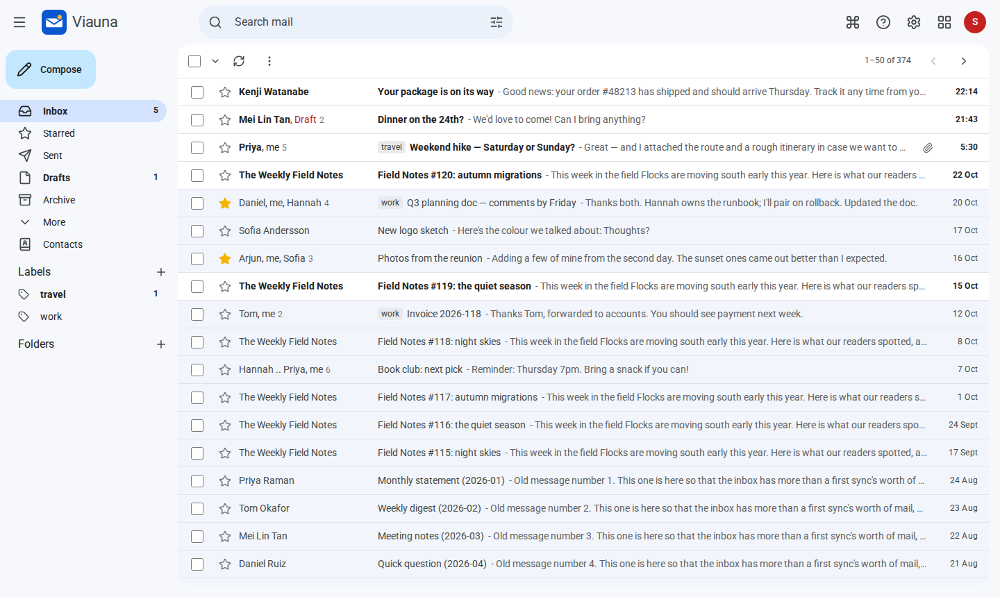
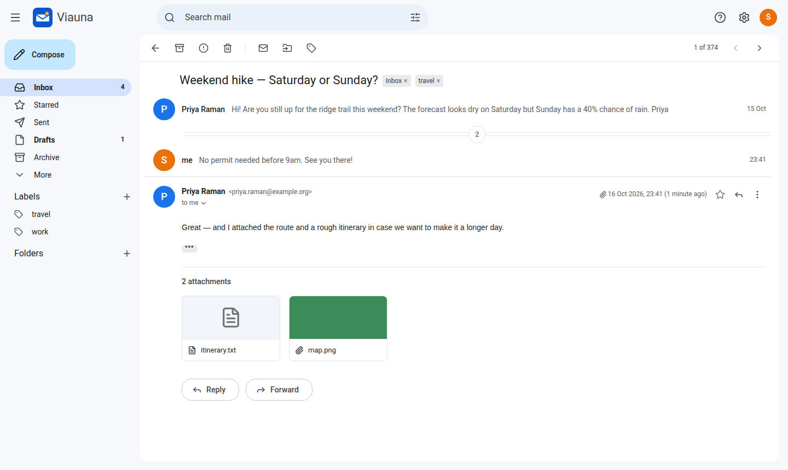
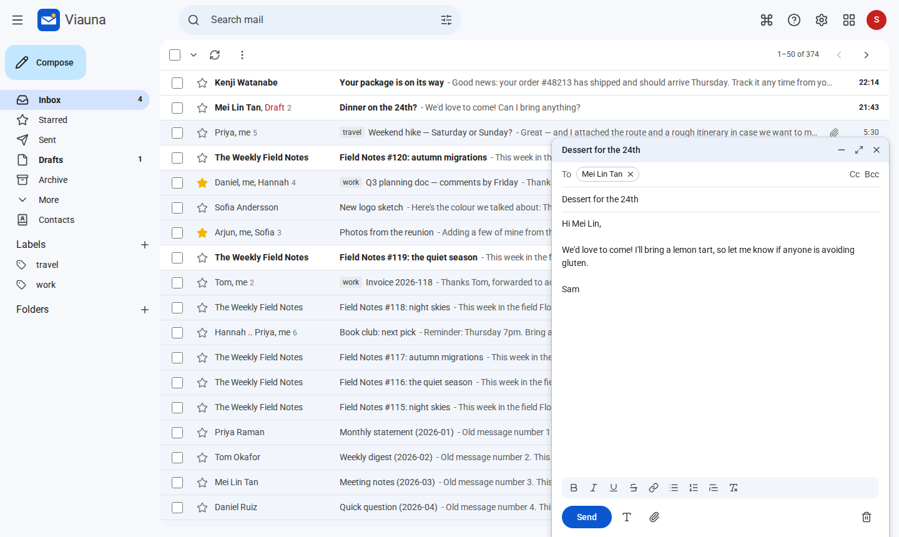
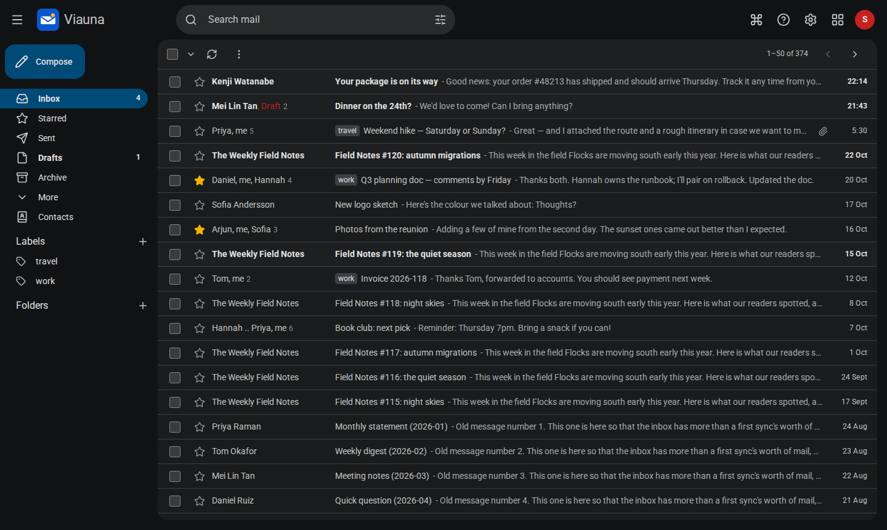
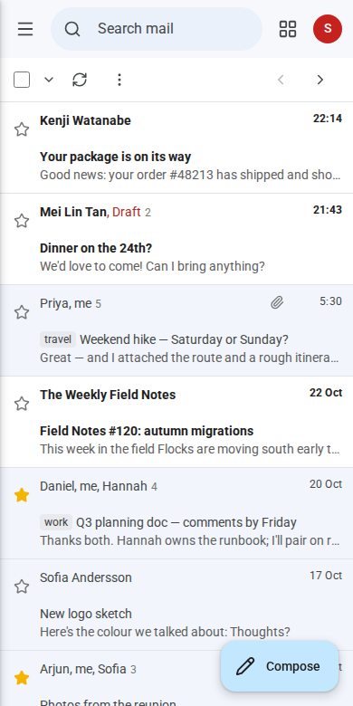

## See it

| | |
|---|---|
|  |  |
|  |  |

## One container, your mail server

Viauna is a single container with no database server to run. Point it at your IMAP and
SMTP server, put it behind your reverse proxy, and sign in with your mailbox address and
password. It's developed against Dovecot, the IMAP server inside Mailu, mailcow and
docker-mailserver, and uses only standard protocols.

[Get started](./self-hosting/getting-started.md) ·
[Read the source](https://github.com/bryanthomaschen/viauna) (AGPL-3.0)

> Viauna is an independent project. It isn't affiliated with, or endorsed by, Google.
